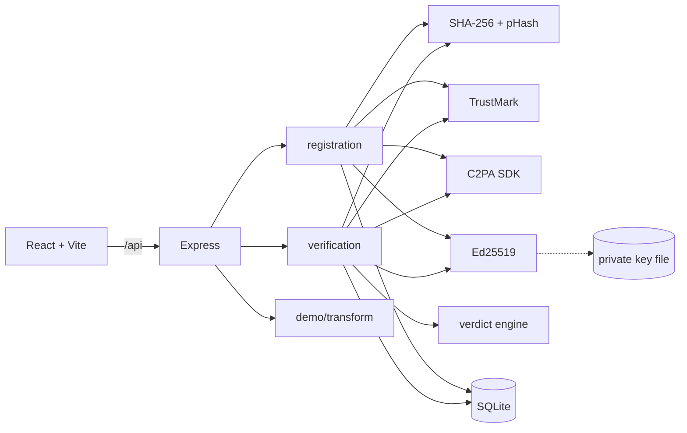

# ProofLens: Proof That Survives the Screenshot

ProofLens is a web application that lets an ordinary person check **where an image came from**
(camera, AI generator or edit, and who registered it) even after the image has been
screenshotted, cropped, compressed and re-shared. It is **precise about what it can and cannot
prove**.

> College engineering MVP. It uses a development signing key and a development C2PA
> certificate, and is not a production trust service.

---

## Problem

Provenance usually travels *inside the file* (EXIF, C2PA Content Credentials). Real media travel
does not preserve the file: platforms strip metadata and re-encode, and a screenshot is a brand-new
file with no history. Cropping and compression defeat many watermarks, and removal tools are free.
The recipient is left with an image that has no credentials, and **missing credentials prove
nothing**. Full statement: [docs/problem-statement.md](docs/problem-statement.md).

## Motivation

Industry standards (C2PA) and AI-generator watermarks attach provenance at creation but are lost in
transit. There is no lightweight way for a recipient to check what they received, and naive tools
either over-claim ("verified!") or confuse "no credentials" with "fake".

## Solution overview

ProofLens attaches provenance at registration in **several independent ways** and, at
verification, combines whatever evidence survived:

| Layer | Survives screenshots? | Role |
|---|---|---|
| SHA-256 of the file | No | exact identity |
| C2PA manifest (official SDK) | No | validated if present |
| TrustMark invisible watermark | Usually | pointer to the registry record |
| Perceptual hash (whole image + 13 regions, screenshot-border removal) | Often | visual lookup / corroboration |
| Ed25519-signed registry record | n/a | authenticates the record |

The signature authenticates the **record**; the other signals grade the **link** between the image
and the record. Three verdicts:

- **VERIFIED PROVENANCE**: a trusted signed record and a sufficiently strong link (exact; pointer + visual agreement; or a unique close visual match).
- **UNKNOWN PROVENANCE**: origin not established. **Not** an accusation of fakery.
- **CONTRADICTED / SUSPICIOUS**: evidence conflicts (altered or forged record, watermark copied onto another picture, broken credential).

## Key features

- Registration with source type, optional pseudonym or **private identity commitment**, privacy settings.
- Ed25519 signing over canonical JSON; proof receipts; public key endpoint.
- EXIF/GPS-free distribution copy with a **TrustMark watermark** and a **C2PA manifest** (soft binding included).
- Verification dashboard: verdict, evidence checklist, fingerprint bit comparison, matched record, can/cannot-conclude lists, full technical report.
- Database-tampering detection (signed contents vs. table rows).
- Demo page: 14 live scenarios (compression, crops, screenshots, chains, **watermark removal**, **watermark transplant forgery**, **record tampering**, unknown image) and a custom transformation-chain builder.
- Measured evaluation over 30 photos × 19 transformations (`npm run evaluate`).

## Architecture



Details: [docs/system-architecture.md](docs/system-architecture.md) ·
[docs/database-design.md](docs/database-design.md).

## Technology stack

| Layer | Technology |
|---|---|
| Frontend | React 19, React Router 7, Vite 8, plain CSS |
| Backend | Node.js (≥ 20; tested on 24), Express 5, multer, helmet, express-rate-limit |
| Database | SQLite via better-sqlite3 |
| Images | sharp (libvips) |
| Cryptography | Node.js `crypto` (Ed25519), `@peculiar/x509` (dev certificate chain) |
| Provenance standards | `@contentauth/c2pa-node` (C2PA read/sign, TrustMark watermark) |
| Testing | Vitest, Supertest |

## System workflow

1. **Register**: validate → SHA-256 → pHashes (global + 13 regions) → strip metadata → embed watermark → attach C2PA → sign record → store.
2. **Share** the distribution copy. It may be compressed, cropped or screenshotted.
3. **Verify**: SHA-256 lookup → C2PA read → pHash (plain + border-trimmed) → watermark decode → candidate records → re-verify signatures and DB consistency → verdict engine → report.

## Verification methodology

Theory, thresholds and calibration: [docs/verification-methodology.md](docs/verification-methodology.md).

## Screenshots

_Add screenshots of the Landing, Verify result (Verified / Unknown / Contradicted), Register and
Demo pages here, e.g. `docs/screenshots/verify-verified.png`._

## Installation

```bash
npm install
cp .env.example .env
npm run keys        # Ed25519 development signing key
npm run models      # TrustMark models (~65 MB)
npm run samples     # 30 Unsplash-licensed sample photos
npm run seed        # register 4 samples for the demo
```

Full guide and troubleshooting: [docs/setup-guide.md](docs/setup-guide.md).

## Environment configuration

All settings are in [.env.example](.env.example) (ports, paths, upload limits, rate limits,
feature switches). Matching thresholds are in
[backend/src/config/index.js](backend/src/config/index.js).

## Running

```bash
npm run dev         # API on :4000 and frontend on :5173 together
# or separately:
npm run dev -w backend
npm run dev -w frontend
```

Open http://localhost:5173.

## API overview

| Method | Path | Purpose |
|---|---|---|
| POST | `/api/media/register` | register + sign |
| POST | `/api/media/verify` | verify (optional receipt) |
| GET | `/api/provenance/:id` | record + re-verified signature |
| GET | `/api/media/:id/file` | distribution copy |
| GET | `/api/keys` | public keys |
| POST | `/api/transform` | apply a transformation chain |
| POST | `/api/demo/run` · GET `/api/demo/results/:id` | scenario suite |
| POST | `/api/demo/tamper` | record-forgery demo |
| GET | `/api/health` | status |

Full reference with examples: [docs/api-documentation.md](docs/api-documentation.md).

## Testing

```bash
npm test            # 78 unit + integration tests
npm run build       # frontend production build
npm run evaluate    # measured evaluation → docs/evaluation-results.md
```

## Results (measured, not estimated)

From [docs/evaluation-results.md](docs/evaluation-results.md): 20 registered photos and 10
unregistered hold-out photos, each under 19 transformations.

- **100%** correct verification after JPEG q20/q50, 40% resize, WebP, metadata removal, 90% crop, phone screenshots, filters, and two transformation chains (3 and 5 steps).
- **0** unregistered photos falsely verified (190 checks).
- **Failures:** off-centre crops (70% top-left 1–2/20, 50% top-left 0/20), 5° rotation (3–4/20), severe chains (0/20). These come out UNKNOWN, never as a false accusation. (Ranges = different evaluation runs; watermark IDs are random per registration.)

Discussion: [docs/transformation-testing.md](docs/transformation-testing.md).

## Demonstration

1. `npm run dev`, open **Demo & tests**, pick the river-valley sample, click **Run 14 scenarios**.
2. Download a transformed image from the table (or build a chain), then verify it on the **Verify** page.
3. Show the forgery card: edit `sourceType` → forged copy's signature fails.
4. Verify an unrelated photo → UNKNOWN, with "does not mean fake" explanation.

Script: [docs/presentation/demo-script.md](docs/presentation/demo-script.md).

## Limitations

Large/off-centre crops and rotations defeat the system. Perceptual hashes can collide. Signatures
prove a record is unaltered, not that its claims are true or who the creator is. Only registered
images (or ones with valid C2PA) can be verified. Full list:
[docs/limitations-and-future-scope.md](docs/limitations-and-future-scope.md).

## Future scope

Local-feature/learned matching for crops, rotation-invariant hashing, HSM keys, a transparency
log, trusted C2PA certificates, capture-time registration, larger independent evaluation.

## Documentation

[problem-statement](docs/problem-statement.md) · [project-overview](docs/project-overview.md) ·
[system-architecture](docs/system-architecture.md) · [database-design](docs/database-design.md) ·
[api-documentation](docs/api-documentation.md) · [security-analysis](docs/security-analysis.md) ·
[verification-methodology](docs/verification-methodology.md) ·
[transformation-testing](docs/transformation-testing.md) ·
[limitations-and-future-scope](docs/limitations-and-future-scope.md) ·
[setup-guide](docs/setup-guide.md) · [presentation/](docs/presentation/)

## Contributors

| Name | Role |
|---|---|
| _Contributor 1_ | _role_ |
| _Contributor 2_ | _role_ |
| _Guide / mentor_ | _role_ |

## Acknowledgements

Sample photos: Unsplash via picsum.photos (Unsplash License). TrustMark and the C2PA SDK:
Content Authenticity Initiative / Adobe (open source).
